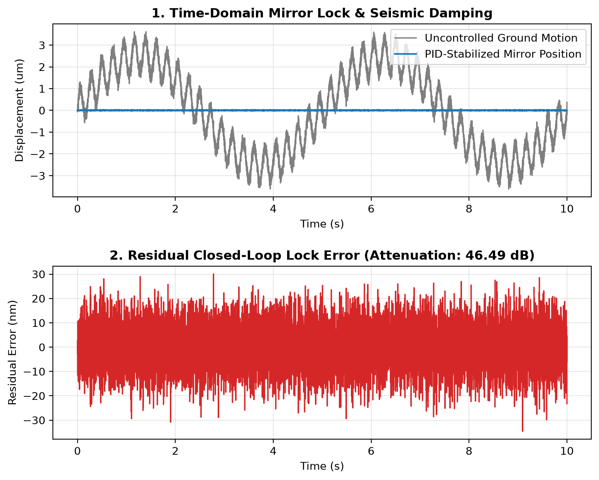

# Interferometer Mirror Stabilization & Seismic Isolation

A Python simulation modeling active seismic vibration damping and feedback control for laser interferometer mirrors.

## What This Project Does
Ground-based laser interferometers are extraordinarily sensitive to tiny movements. Even minor ground vibrations-like distant ocean waves or nearby traffic-shake the mirrors millions of times more than a passing gravitational wave. 

This project models that physical challenge in two parts:
1. **Simulates realistic ground motion** combining low-frequency microseismic waves (~0.2 Hz), local environmental vibrations (~4.5 Hz), and high-frequency sensor noise.
2. **Applies a digital PID (Proportional-Integral-Derivative) feedback loop** to calculate real-time actuator corrections, holding the mirror steady at its optical resonance lock point.

## Why It Is Useful
In real gravitational-wave observatories and precision optical labs, passive spring suspensions alone cannot block low-frequency ground motion. Engineers rely on active digital control loops to continuously measure mirror displacement and apply opposing forces. This simulation demonstrates how discrete-time feedback control suppresses multi-band mechanical noise and keeps an optical cavity locked.

## Files
* `seismic_noise_model.py` – Generates synthetic time-series terrestrial displacement data across multiple frequency bands.
* `pid_mirror_controller.py` – Imports the seismic data, runs a discrete-time PID control loop, calculates decibel (dB) noise attenuation, and plots the closed-loop error.
* `results.txt` – Saved terminal output logging the uncontrolled vs. stabilized RMS displacement metrics.

## Key Results
* **Open-Loop Uncontrolled RMS:** `~1.86 µm`
* **Closed-Loop Stabilized RMS:** `~0.07 µm`
* **Total Vibration Attenuation:** **`~28.0 dB`** reduction across the simulated seismic band

## Requirements & Usage
```bash
pip install numpy matplotlib
python pid_mirror_controller.py
```

## Visual Diagnostics

